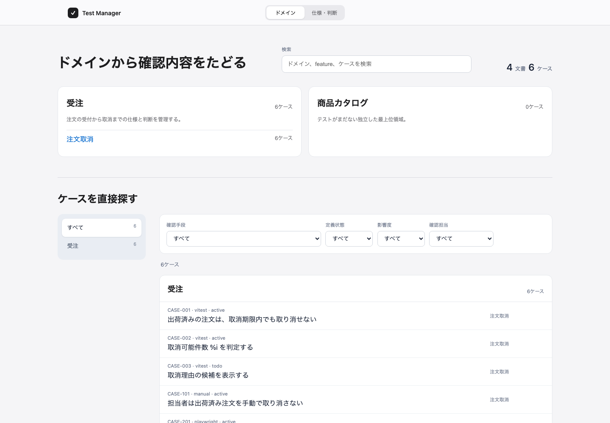
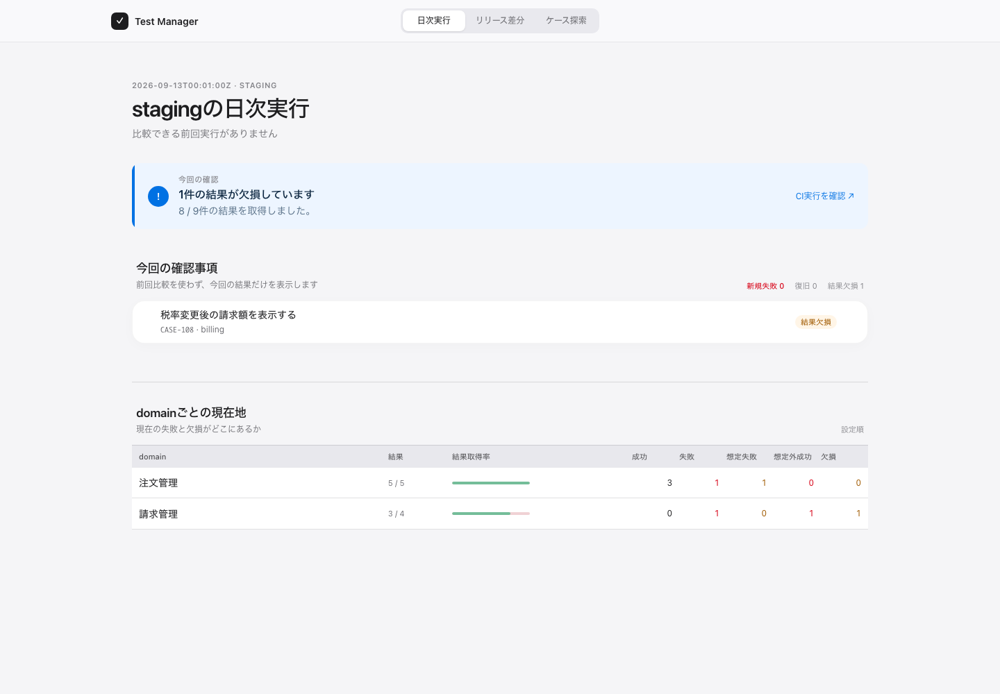
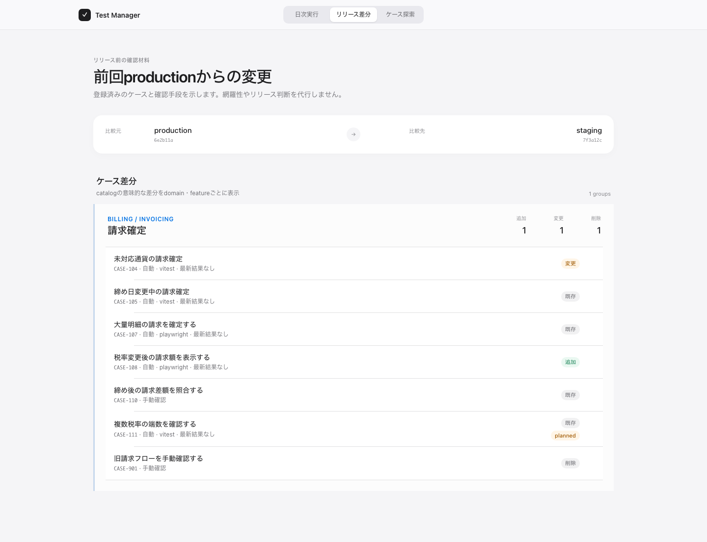

# test-manager

テストコード、手動テスト、仕様・判断文書を、実行せずに一つのカタログへまとめる CLI です。

プロジェクト内に散らばった Vitest、Playwright、Storybook、手動ケースを静的解析し、「このテストはどの仕様に属するか」「参照先が消えていないか」「必要な分類が記録されているか」を検査します。検査済みの情報から、domainを入口に仕様・判断をたどる画面と、ケースを複数語検索や分類で絞り込む画面を生成できます。

カタログ画面は検証済みcatalogを純粋なTypeScript rendererへ渡して静的HTMLへ変換します。CLI実行時にWebフレームワークを起動せず、持ち運べる生成物をtest-managerのmanaged output境界から公開します。

トップ画面のdomain一覧は、配下の文書ごとにケース数とlayer別の件数を示します。`belongsTo` の参照先にできる文書のうち配下にケースが1件もないものは「ケースのない文書」として一覧します。網羅性の判定ではなく、確認内容がまだ登録されていない事実の表示です。



test-manager はテストランナーそのものではありません。runner reporterが出力した事実をCI manifestと統合し、テスト定義と実行結果を日次・リリース差分画面へ接続します。

## 品質ダッシュボード

実行結果をカタログへ照合し、日次実行とリリース差分を生成できます。画面が示すのは登録済みケース・取得済み結果・catalog差分の事実であり、網羅性やリリース可否は判定しません。[承認済みUIプロトタイプ](prototypes/quality-dashboard/index.html) と [利用場面・画面設計](docs/quality-dashboard-design.md) を参照してください。

### 日次実行

CI開始前に確定したmanifestと、Vitest・Playwright reporterが生成したunit artifactを一つの`TestRun`へ統合します。成功・失敗だけでなく、想定失敗、想定外成功、skip、retry成功、timeout、結果欠損、runnerの途中終了を区別して表示します。比較対象は同じenvironment・scopeの前回runに限定し、条件が異なる場合は比較不能と表示します。



`daily`・`dashboard` に `--history-dir <path>` を渡すと、そのディレクトリ直下の `*.json` を過去の `TestRun` として読み、日次画面に直近の推移、不安定なケース、失敗が続いているケースを追加します。

- 今回のrunと同じenvironment・scopeのrunだけを置きます。異なるrunがあれば生成を拒否します。今回より新しいrunは使いません
- 直近 `--history-window <n>` 回（既定14回）を対象にします
- 不安定な回は、再試行で通った回（runnerがflakyと報告した回を含む）と、同じcommitの別の回では通ったのに失敗した回です。毎回失敗するケースは不安定ではなく「失敗が続いているケース」（2回以上連続）として示します。連続失敗は、そのケースのskip・欠損などの失敗以外の結果で途切れます
- 推移の件数はcatalogに存在するケースだけを数え、成功、失敗・想定外成功、欠損、skip・想定失敗に分けます。シンボリックリンクの `*.json` も読み、サブディレクトリは読みません
- 日次の `TestRun` をこのディレクトリへ積み上げる方法（専用ブランチ、オブジェクトストレージ、CI artifactなど）は利用側で選びます

### リリース差分

前回production commitと現在のstaging commitで生成したcatalog snapshotを比較し、追加・変更・削除されたケースをdomain・feature単位に表示します。自動テストは任意でstagingの最新結果を添えます。手動ケースは任意で手動実施結果を添え、確認したcommit・日時と、確認後にケースの定義が変わったかを示します。



## 想定する使い方

たとえば、ある仕様に対して単体テスト、E2E、Storybook、手動確認が存在するとします。それぞれへ同じ `belongsTo` と固有のケース ID を付けると、test-manager は次を行います。

1. 設定した glob から仕様・判断文書とテスト定義を探す
2. ソースコードを実行せず、対応する宣言だけを AST で読み取る
3. ID の重複、参照切れ、親子関係、必須項目、分類語彙を検査する
4. 仕様・判断文書と全テストケースを横断できる静的サイトと `catalog.json` を生成する

CI では `check` を実行して、不整合のある変更を検出できます。人が仕様やテストを調べるときは、`build` したサイトから、領域・情報源・状態・プロジェクト独自の分類でケースを探せます。

## 試す

現在はリポジトリから実行します。

```sh
pnpm install --frozen-lockfile
pnpm exec playwright install chromium
pnpm test

node dist/cli-entry.js check --config fixtures/valid/test-manager.yaml
node dist/cli-entry.js build \
  --config fixtures/valid/test-manager.yaml \
  --out /tmp/test-manager-site

node dist/cli-entry.js daily \
  --config fixtures/quality-dashboard/test-manager.yaml \
  --manifest fixtures/quality-dashboard/manifest.json \
  --completed-at 2026-09-13T00:01:00Z \
  --unit-artifact fixtures/quality-dashboard/vitest.test-manager-unit.json \
  --unit-artifact fixtures/quality-dashboard/playwright.test-manager-unit.json \
  --out /tmp/test-manager-daily

node dist/cli-entry.js dashboard \
  --config fixtures/quality-dashboard/test-manager.yaml \
  --current-run /path/to/current-run.json \
  --previous-run /path/to/previous-run.json \
  --production-snapshot /path/to/production/release-catalog.json \
  --staging-snapshot /path/to/staging/release-catalog.json \
  --out /tmp/test-manager-dashboard
```

`pnpm test` は型付きビルドとVitestを実行した後、Playwright Testで生成dashboardを実ブラウザ検証します。E2Eはdesktopとmobile viewportで同じシナリオを実行し、主要画面の移動、ケース検索、キーボード操作、フォーカス表示、横方向のはみ出しを確認します。E2Eだけを再実行する場合は `pnpm test:e2e` を使用します。

Linux CIではブラウザのシステム依存も必要なため、`.github/workflows/ci.yml` が `pnpm exec playwright install --with-deps chromium` を実行します。ローカルのmacOSでは上記の `playwright install chromium` で十分です。

consumerリポジトリでtest-managerをcommit SHAに固定して実行し、Vitest・Playwrightの結果から統合dashboard artifactを生成する場合は、[GitHub Actions導入例](examples/github-actions/README.md)を使用できます。

E2Eの画面操作は `src/quality-site.e2e.pages.ts` の薄いPage Objectへ集約し、fixture生成とHTTP応答は `src/quality-site.e2e.fixture.ts` が担当します。specには利用者が達成するシナリオだけを記述します。

`check` は検査成功時に `0`、診断がある場合に `1`、CLI の使い方が不正な場合に `2` を返します。`build`、`daily`、`snapshot`、`release`、`dashboard` は入力検査成功後だけ、test-manager所有マーカーを持つ安全な出力ディレクトリへ生成します。

`dashboard` は日次、リリース差分、カタログを一つのリンク切れがない静的サイトとして生成します。`--current-run` は日次表示だけに使用します。リリース差分へ最新のstaging結果を添える場合は、別途 `--latest-staging-run <path>` を指定します。表示するカタログと比較先の意味が食い違わないよう、現在のconfigから得たcatalogとstaging snapshotが一致しない場合は生成を拒否します。

日次・リリース差分・統合dashboardの標準スタイルはtest-manager自身が同梱します。見た目を置き換える必要がある場合だけ `--stylesheet <path>` を指定します。

リリース差分では、productionとstagingの各checkoutで `snapshot --config <path> --commit <sha> --out <path>` を実行します。その `release-catalog.json` 2件を `release --production-snapshot <path> --staging-snapshot <path> --out <path>` へ渡します。stagingの実行事実も表示する場合は、同じcommit・`staging`環境のrunを `--latest-staging-run` で指定します。

PRごとの差分は `pr-comment --base-snapshot <path> --head-snapshot <path> [--out <path>]` で、追加・変更・削除されたケースをdomain・featureごとに並べたMarkdownとして出力できます。投稿はCIなど利用側が行います（[GitHub Actions導入例](examples/github-actions/README.md#prへケースの変更をコメントする)）。

手動ケースの実施結果は `--manual-results <path>` で渡します（`release`・`dashboard`、複数指定可）。記録した場所や外部ツールは問わず、次の形式のJSONへ変換して渡します。

```json
{
  "schemaVersion": 1,
  "environment": "staging",
  "commit": "7f3a12c",
  "executedBy": "qa-team",
  "results": [
    { "caseId": "CASE-101", "executedAt": "2026-10-20T10:00:00+09:00", "outcome": "passed", "note": "端末Bで確認", "evidenceUrl": "https://example.com/evidence/1" }
  ]
}
```

- `outcome` は `passed`、`failed`、`blocked` のいずれかです。`note` と `evidenceUrl`（HTTP(S)）は任意です
- 同じケースに複数の結果がある場合は、`executedAt` が最も新しいものを表示します。同じ時刻で結果やcommitが異なる場合は拒否します。日付は記録されたoffsetのまま表示します
- `commit` は完全なSHAでも、snapshotのcommitと一意に対応する短縮SHAでも構いません
- 確認したcommitのcatalog snapshotと比較し、確認後にケースの定義が変わっていれば「確認後に変更あり」を示します。productionとstaging以外のcommitで確認した場合は、そのcommitのsnapshotを `--manual-snapshot <path>`（複数指定可）で渡します
- `staging` 以外の環境の結果、そのcommitのcatalogに存在しないケースや手動ケース以外への結果は拒否します

manifestにはrun ID、attempt、environment、commit、scope、開始時刻、HTTP(S)のCI URL、実行予定unitとcase IDだけを記録します。GitHub Actions context全体や機密情報は保存しません。unit artifactが生成されなかった場合は`artifactMissing`、runnerが結果を残して途中終了した場合は`runnerError`などのincomplete理由として扱い、両者を混同しません。attachmentは設定したartifact root内だけを許可し、相対参照として保存します。

## プロジェクトへ設定する

プロジェクトのルートなどに `test-manager.yaml` を作ります。glob の基準は、この設定ファイルが置かれたディレクトリです。

`test-manager init [--dir <path>] [--force]` は、`check` が通る最小の `test-manager.yaml` と例の domain 文書 `knowledge/example.md` を作ります。既存の設定は `--force` を付けたときだけ上書きし、既存の文書は上書きしません。作成後に `check` を実行します。`knowledge/` にfrontmatterのないMarkdownが既にあるなど、プロジェクト側の理由で `check` が失敗した場合も、作成したファイルは残します。リポジトリの調査や設定の推測はしません。テストの置き場所に合わせた `discovery.sources` や文書の取り込みは、人やAIエージェントが行い、`check` の診断で確かめます。

設定の構造は `test-manager schema` が出力するJSON Schema（[`schema/test-manager.schema.json`](schema/test-manager.schema.json)と同じ内容）で確認できます。kind名や `requiredWhen` の参照先など、複数の値にまたがる規則はJSON Schemaではなく `check` が検査します。parserを変更したら `pnpm schema` で再生成します。

```yaml
version: 1
idPattern: "^(?:[a-z][a-z0-9-]*|CASE-[0-9]{3})$"

discovery:
  documents: ["knowledge/**/*.md"]
  sources:
    e2e:
      description: 起動したアプリケーションを画面から操作する。手動のケースもここに入れる
      playwright: ["journeys/**/*.spec.ts"]
      manual: ["knowledge/**/*.manual.yaml"]
    unit:
      vitest: ["src/**/*.test.ts"]
    ui:
      storybook: ["src/**/*.stories.tsx"]

documents:
  kinds:
    domain:
      description: 業務領域
      parent: { required: false, targetKinds: [] }
    feature:
      description: domainに属する機能
      parent: { required: true, targetKinds: [domain] }
    decision:
      description: 判断や制約
      parent: { required: true, targetKinds: [feature] }
  displayOrder:
    domain: [orders, billing, scheduling]
    feature: [order-cancellation]

case:
  fields:
    belongsTo:
      type: reference
      targetKinds: [domain, feature]
      placement: classification
      required: true
    refs:
      type: reference-list
      targetKinds: [domain, feature, decision]
      placement: classification
      required: false
      uniqueItems: true
    impact:
      label: 影響度
      type: integer-enum
      placement: classification
      required: true
      values:
        1: { label: 限定的, description: 影響が限定的 }
        2: { label: 主要操作, description: 主要操作に影響する }
        3: { label: 主要業務, description: 主要な利用目的を阻害する }
    reason:
      type: text
      placement: detail
      required: false
```

### discovery

どのファイルを読み取るかを指定します。

- `documents`: YAML frontmatter を持つ Markdown
- `sources`: ケースを読み取るファイル。テスト層（layer）ごとに、記述方式をキーにして glob を並べます
  - layer の名前: そのファイル群が確かめるテスト層。`unit`、`integration`、`e2e` などプロジェクトで自由に名付けます。書いた順に画面へ並べます。`1` のような整数だけの名前は、順序が保てないため使えません
  - 記述方式: `manual`（1 ファイルに 1 ケースを記述した YAML）、`vitest`、`playwright`、`storybook`。1つの layer に1つ以上書きます
  - `description`: 任意。その layer が何で決まるかを書きます。人によって解釈が分かれやすいため、「どの実行設定で動くか」のように事実で書くことを勧めます。カタログのトップ画面に表示します
  - 同じ記述方式を複数の layer に書き、パスで層を分けられます。たとえば integration テストを `*.integration.test.ts` とする場合、unit 側は `src/**/!(*.integration).test.ts` のように除外して重複を避けます

設定した glob が 1 件も見つからない場合や、一つのファイルが複数の設定に重複して一致した場合は診断します。

### documents.kinds

仕様・判断文書の種類と、許可する親子関係を定義します。`parent.required` で親の必須性を、`targetKinds` で親として許可する種類を指定します。

`documents.displayOrder` には、kindごとの安定した表示順を指定できます。実行結果によって順序は変わらず、一覧上の位置を保ちます。列挙していない文書は、指定済み文書の後ろへID順で表示します。存在しないID、kindが異なるID、重複したIDは設定エラーです。

### case.fields

プロジェクトで各ケースに記録する項目を定義します。フィールド名は固定されていませんが、`belongsTo` は必須の参照項目です。

利用できる型は `reference`、`reference-list`、`enum`、`integer-enum`、`text`、`text-list` です。`required`、条件付き必須の `requiredWhen`、`minItems`、`uniqueItems` も設定できます。`requiredWhen` の `field` には他のcase項目のほか `source` と `layer` を指定できます。`equals: playwright` のようにケースの記述方式（`manual`、`vitest`、`playwright`、`storybook`）で、`equals: e2e` のように `discovery.sources` で定義したテスト層で必須を切り替えられます。複数の値のどれかで必須にする場合は、`equals` の代わりに `in: [e2e, integration]` のように列挙します。安定した英語のfield keyやenum valueを変えずに、任意の`label`で画面上の日本語表示名を指定できます。

`refs` に、そのケースの `belongsTo` と同じ文書や、その祖先（親の文書をたどったもの）を書くと TM128 で診断します。`belongsTo` で既に決まっている関係を二重に書かないためです。存在しない文書への参照と同じく、診断されたケースはカタログに含めません。`refs` 以外にプロジェクトが定義した `reference-list` の項目は、意味がプロジェクトごとに違うため対象にしません。

`placement` は記述場所とサイト上での扱いを決めます。

- `classification`: `@case` に記述し、一覧の絞り込みに使う項目
- `detail`: `@case-doc` に記述する条件や理由などの詳細

設定に未知のキー、矛盾した必須条件、存在しない文書 kind への参照がある場合は、起動時に拒否します。

## 仕様・判断とケースを記述する

### 仕様・判断文書

Markdown 先頭の YAML frontmatter に、ID、種類、タイトル、任意の親と関連文書を記述します。

```md
---
id: order-cancellation
kind: feature
title: 注文キャンセル
parent: orders
---

注文キャンセルに関する判断と制約を管理します。
```

文書 ID の重複、存在しない親・関連文書、許可されていない親 kind、親関係の循環を検出します。

### Vitest

`@case` をテスト宣言の直前に置き、ケース ID を `meta.caseId` に記述します。条件や理由が必要なら、callback 冒頭の `@case-doc` に記述します。

```ts
/**
 * @case
 * belongsTo: order-cancellation
 * refs: [cancellation-policy]
 * impact: 3
 */
it(
  '期限を過ぎた注文をキャンセルできない',
  { meta: { caseId: 'CASE-001' } },
  () => {
    /**
     * @case-doc
     * reason: 確定済みの出荷処理と矛盾させないため
     */
    // test body
  },
);
```

プロジェクトで `meta.caseId` を型安全に使う場合は、Vitest の metadata を拡張します。

```ts
import '@vitest/runner';

declare module '@vitest/runner' {
  interface TaskMeta {
    caseId?: string;
  }
}
```

### Playwright

ケース ID は `case-id` annotation に記述します。

```ts
/**
 * @case
 * belongsTo: order-cancellation
 * impact: 3
 */
test(
  '期限切れの表示ではキャンセル操作が無効になる',
  {
    annotation: { type: 'case-id', description: 'CASE-201' },
  },
  async () => {
    // test body
  },
);
```

`enum` の項目に `playwrightTag` を指定すると、Playwright のケースではその値をタグから読みます。`@case` には書きません。

```yaml
case:
  fields:
    rank:
      type: enum
      placement: classification
      required: true
      playwrightTag: "@rank-{value}"
      values:
        S: { description: 壊れると金額や権限に関わる }
        A: { description: 主要な操作に影響する }
```

```ts
test.describe('請求書', { tag: '@regression' }, () => {
  /**
   * @case
   * belongsTo: invoice-issue
   */
  test(
    '請求書を発行できる',
    { tag: '@rank-A', annotation: { type: 'case-id', description: 'CASE-202' } },
    async () => {},
  );
});
```

- `{value}` を enum の値に置き換えたタグを読みます。テンプレートに合っても値が enum にないタグや、どの項目にも合わないタグは無視し、Playwright の絞り込みなどに使えます
- テストと、それをコード上で囲む `test.describe` のタグを合わせて読みます。別の関数の中で定義したテストを `test.describe` から呼ぶ場合、その `test.describe` のタグは読めません（Playwright は実行時に付けます）
- 1つの項目に2つ以上の値のタグがある場合（TM212）、タグを静的に読めない場合（変数の options、spread、変数のタグなど。TM211）、タグで読む項目を `@case` に書いた場合（TM213）は診断します
- テスト名の中に書いたタグ（`'請求書を発行できる @smoke'`）は読みません
- Vitest と手動ケースでは、これまでどおり `@case` に書きます

### Storybook

Story の明示的な `name` の先頭へケース ID を入れます。

```ts
/**
 * @case
 * belongsTo: order-cancellation
 * impact: 2
 */
export const Disabled = {
  name: '[CASE-301] キャンセルできない状態',
};
```

### 手動ケース

1 YAML ファイルに 1 ケースを記述します。`steps` は操作と期待結果の組です。

```yaml
id: CASE-101
title: オペレーターが期限切れの注文をキャンセルできない
belongsTo: order-cancellation
impact: 3
steps:
  - action: 期限切れの注文を開く
    expected: キャンセル操作が無効である
```

手動ケースも「何を確認するか」の定義として扱い、実施結果はケースのファイルに書きません。実施結果はリリース差分の生成時に `--manual-results` で渡します。

## CI で検査する

依存関係のインストールとビルド後に `check` を実行します。

```sh
node dist/cli-entry.js check --config ./test-manager.yaml
```

診断はファイル、行、列、診断コード、対象、理由を含みます。たとえば、ケースの belongsTo が存在しない、ID が重複している、必須項目が欠けている、といった変更をマージ前に検出できます。

## 静的解析の対応境界

対応するのは、各ランナーから直接 import した標準宣言、静的文字列タイトル、object literal の options、inline 配列リテラルの `each`、object literal の Story です。

動的タイトル、動的 each、独自 wrapper、外部データからの生成、Story factory は、診断対象または対象外として明示します。対象ソースを実行して推測することはありません。

ツールが検査するのは構造的な整合性です。ケース名が確認内容を正しく表しているか、条件・理由が十分か、実装と記述が意味的に一致しているかは、人がレビューします。

## 出力の安全性と再現性

- Markdown 本文とソース断片は HTML として実行せず、エスケープして表示します
- 生成物には生成日時や絶対パスを含めません
- プロジェクトルートと、その祖先への出力を拒否します
- test-manager の marker がない既存ディレクトリは置換しません
- 同じ入力からは同じファイルツリーを生成します
